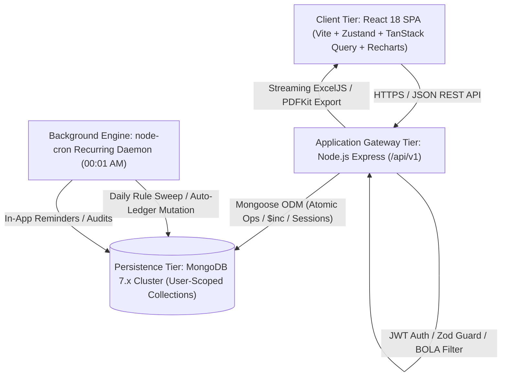
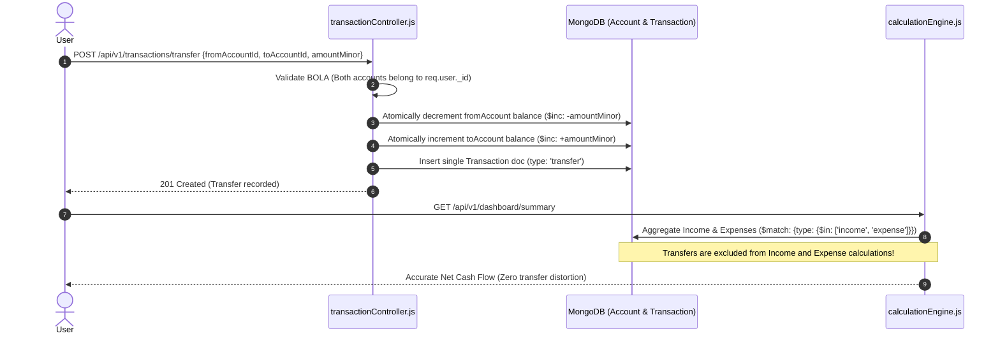
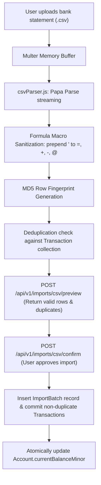
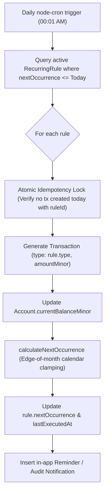

# SmartSpend — System Architecture Documentation (ARCHITECTURE.md)

**Platform:** SmartSpend  
**Version:** 1.0.0  
**Architectural Standard:** Decoupled 3-Tier SaaS (React 18 SPA + Node.js Express REST API v1 + MongoDB 7.x)

---

## 1. System Architecture Overview

SmartSpend is designed around strict separation of concerns, deterministic financial math, and bulletproof tenant isolation. The platform separates interactive visual analytics and client-side charting from transactional ledger mutations and background daemons.



---

## 2. Decoupled 3-Tier Architecture Details

### Tier 1: Client Presentation Tier (React 18 SPA)
- **Framework & Tooling:** React 18, Vite, Tailwind CSS.
- **Data Fetching & Cache:** TanStack Query (`@tanstack/react-query`) for background revalidation, stale-time caching, and optimistic mutations.
- **State Management:** Zustand stores (`authStore`, `dashboardStore`, `accountStore`, `transactionStore`, `budgetStore`, `recurringStore`, `goalStore`, `notificationStore`, `importStore`).
- **Interactive Visualizations:** Recharts for cash flow velocity dual-gradient area curves, category donut charts, and monthly comparison bars.
- **Icons & Accessibility:** Lucide React, semantic HTML5, keyboard navigation, and responsive mobile-first viewports.

### Tier 2: Application & Gateway Tier (Node.js & Express)
- **RESTful API Gateway:** Versioned prefix `/api/v1` for future mobile app integration.
- **Security Boundary:** Helmet HTTP headers, CORS with credential handling, `express-rate-limit` DDoS defense, HttpOnly cookies, and strict JWT validation.
- **Validation & Sanitization:** Two-stage ingress:
  1. Zod schemas enforcing 64-bit integer paise currency (`DEC-002`).
  2. Input sanitization neutralizing HTML tags and script payloads (`DEC-009`).
- **Calculation Engine:** Headless mathematical engine (`calculationEngine.js`) computing derived balances, transfer neutrality, zero-income safe savings rates, and gapless time series.
- **Scheduled Background Daemon:** `node-cron` daemon executing daily at `00:01 AM` with forward calendar math, clamping end-of-month dates (Jan 31 $\to$ Feb 28), and atomic duplicate prevention (`DEC-005`).
- **Document Streaming Pipeline:** Memory-efficient document generation via `ExcelJS` (multi-sheet workbooks) and `PDFKit` (printable statements) (`DEC-011`).

### Tier 3: Data Persistence Tier (MongoDB 7.x)
- **Tenant Isolation:** Every user-owned document enforces `{ userId: req.user._id }`. Request bodies supplying `userId` are strictly disregarded (`DEC-007`).
- **Monetary Storage Standard:** All currency fields (`amountMinor`, `openingBalanceMinor`, `currentBalanceMinor`, `targetAmountMinor`) are strictly stored as 64-bit integer paise. Floating-point numbers are prohibited (`DEC-002`).
- **Compound Indexes:** Optimized indexes on `{ userId: 1, transactionDate: -1 }`, `{ userId: 1, type: 1 }`, `{ userId: 1, monthYear: 1 }`, and `{ userId: 1, status: 1 }`.
- **Append-Only Auditing:** Dedicated `AuditLog` collection with ODM-level mutation locks for forensic tracking (`DEC-012`).

---

## 3. Core Data Flow Workflows

### A. Dual-Entry Transfer Neutrality Workflow (DEC-003)



### B. CSV Bank Statement Ingestion & Sanitization Pipeline (DEC-006)



### C. Recurring Bill Scheduler & Calendar Forward Math (DEC-005)



---

## 4. Production Directory Architecture

```
SmartSpend/
├── server/
│   ├── src/
│   │   ├── config/            # constants.js, env.js, db.js
│   │   ├── controllers/       # auth, account, category, transaction, dashboard,
│   │   │                      # budget, notification, recurring, import, goal, reports
│   │   ├── middleware/        # authMiddleware, errorHandler, notFound
│   │   ├── models/            # User, Account, Category, Transaction, Budget,
│   │   │                      # RecurringRule, SavingsGoal, GoalContribution,
│   │   │                      # Notification, ImportBatch, AuditLog
│   │   ├── routes/            # REST API endpoints mounted on /api/v1/*
│   │   ├── services/
│   │   │   ├── budget/        # budgetEvaluator.js (idempotent threshold alerts)
│   │   │   ├── export/        # csvExporter.js
│   │   │   ├── finance/       # calculationEngine.js (balance rollups, savings rates)
│   │   │   ├── import/        # csvParser.js (formula injection defense, MD5 fingerprints)
│   │   │   ├── recurring/     # recurringScheduler.js (cron daemon & date clamping)
│   │   │   └── reports/       # exportService.js (ExcelJS multi-sheet, PDFKit)
│   │   ├── utils/             # logger.js, money.js (INR paise math), sanitize.js
│   │   ├── validators/        # Zod schemas (account, budget, goal, transaction)
│   │   ├── app.js             # Express application gateway
│   │   └── server.js          # Entrypoint & background cron launcher
│   └── tests/                 # 12 Vitest + Supertest automated test suites
├── client/
│   ├── src/
│   │   ├── components/        # ProtectedRoute, Layout, Modals, Forms
│   │   ├── pages/             # Dashboard, Transactions, Accounts, Budgets,
│   │   │                      # Goals, Reports, Recurring, Import, Categories, Settings
│   │   ├── store/             # Zustand stores for each domain module
│   │   ├── App.jsx            # React Router v6 navigation & layout
│   │   ├── index.css          # Tailwind CSS directives
│   │   └── main.jsx           # Client root mounting
│   └── vite.config.js         # Vite configuration with API reverse proxy
```
