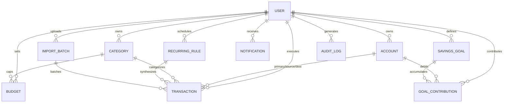

# SmartSpend — Database Architecture & Schema Specification (DATABASE_SCHEMA.md)

**Database Engine:** MongoDB 7.x  
**Object-Data Mapper:** Mongoose ODM  
**Currency Standard:** 64-bit Integer Minor Currency (Paise for INR: ₹1.00 = 100 paise)

---

## 1. Entity-Relationship Model

---

## 2. Collection Schemas & Data Constraints

### 1. `User` Collection (`server/src/models/User.js`)
Stores authenticated user accounts with password hashes and token invalidation versions.

| Field | Type | Validation / Constraints | Default | Notes |
| :--- | :--- | :--- | :--- | :--- |
| `_id` | ObjectId | Primary Key | Auto | Unique identifier |
| `name` | String | Required, trim, 2-50 chars | - | Full legal or display name |
| `email` | String | Required, unique, lowercase, regex email | - | Indexed for login |
| `password` | String | Required, min 8 chars, hashed with bcrypt | - | `select: false` by default |
| `currency` | String | Required, uppercase, enum: `['INR']` | `'INR'` | Minor unit standard |
| `tokenVersion` | Number | Integer $\ge 0$ | `0` | Incremented on password change to invalidate old JWTs |
| `createdAt` | Date | Auto timestamp | `Date.now` | Account registration time |
| `updatedAt` | Date | Auto timestamp | `Date.now` | Last update time |

---

### 2. `Account` Collection (`server/src/models/Account.js`)
Classifies user financial accounts and tracks liquid balances.

| Field | Type | Validation / Constraints | Default | Notes |
| :--- | :--- | :--- | :--- | :--- |
| `_id` | ObjectId | Primary Key | Auto | Unique identifier |
| `userId` | ObjectId | Required, ref: `'User'`, Indexed | - | Multi-tenant isolation |
| `name` | String | Required, trim, 2-50 chars | - | e.g. "HDFC Salary", "Cash" |
| `accountType` | String | Enum: `['cash', 'savings', 'current', 'wallet', 'credit_card', 'emergency_fund']` | - | Account classification |
| `openingBalanceMinor` | Number | Required, Integer paise (DEC-002) | `0` | Opening balance in paise |
| `currentBalanceMinor` | Number | Required, Integer paise | Same as opening | Mutated atomically |
| `currency` | String | Enum: `['INR']` | `'INR'` | Currency representation |
| `color` | String | Hex color regex | `'#047857'` | UI visual badge |
| `icon` | String | String | `'Wallet'` | Lucide icon name |
| `isArchived` | Boolean | Boolean | `false` | Soft-deletion flag |
| `timestamps` | - | `createdAt`, `updatedAt` | - | - |

**Compound Indexes:**
- `{ userId: 1, name: 1 }` (unique constraint per user)
- `{ userId: 1, isArchived: 1 }`

---

### 3. `Category` Collection (`server/src/models/Category.js`)
Taxonomy of income and expenditure streams.

| Field | Type | Validation / Constraints | Default | Notes |
| :--- | :--- | :--- | :--- | :--- |
| `_id` | ObjectId | Primary Key | Auto | Unique identifier |
| `userId` | ObjectId | Ref: `'User'`, Nullable for system defaults | `null` | Tenant or system-wide |
| `name` | String | Required, trim, 2-50 chars | - | Category label |
| `type` | String | Enum: `['income', 'expense']` | `'expense'` | Classification |
| `icon` | String | String | `'Tag'` | Lucide icon identifier |
| `color` | String | Hex color regex | `'#64748b'` | Color representation |
| `isDefault` | Boolean | Boolean | `false` | If true, cannot be deleted |
| `timestamps` | - | `createdAt`, `updatedAt` | - | - |

**Compound Indexes:**
- `{ userId: 1, type: 1 }`
- `{ userId: 1, name: 1, type: 1 }`

---

### 4. `Transaction` Collection (`server/src/models/Transaction.js`)
Core immutable ledger document tracking income, expense, and dual-entry transfers.

| Field | Type | Validation / Constraints | Default | Notes |
| :--- | :--- | :--- | :--- | :--- |
| `_id` | ObjectId | Primary Key | Auto | Unique identifier |
| `userId` | ObjectId | Required, ref: `'User'`, Indexed | - | Multi-tenant isolation |
| `type` | String | Enum: `['income', 'expense', 'transfer']` | - | Transaction nature |
| `amountMinor` | Number | Required, integer $\ge 1$ paise (DEC-002) | - | Strictly positive integer |
| `currency` | String | Enum: `['INR']` | `'INR'` | Minor unit standard |
| `accountId` | ObjectId | Ref: `'Account'`, Required for income/expense | `null` | Target ledger account |
| `fromAccountId` | ObjectId | Ref: `'Account'`, Required for transfer | `null` | Sourced balance |
| `toAccountId` | ObjectId | Ref: `'Account'`, Required for transfer | `null` | Destination balance |
| `categoryId` | ObjectId | Ref: `'Category'`, Optional for transfers | `null` | Spending category |
| `transactionDate` | Date | Required, Indexed | `Date.now` | Effective date |
| `description` | String | Required, trim, 1-250 chars | - | Human description |
| `notes` | String | Max 500 chars | `''` | Optional remarks |
| `paymentMethod` | String | Enum: `['cash', 'upi', 'net_banking', 'debit_card', 'credit_card', 'cheque', 'other']` | `'upi'` | Ingress rail |
| `source` | String | Enum: `['manual', 'recurring', 'csv_import']` | `'manual'` | Origin audit flag |
| `importBatchId` | ObjectId | Ref: `'ImportBatch'` | `null` | For bulk import rollback |
| `recurringRuleId` | ObjectId | Ref: `'RecurringRule'` | `null` | Linked scheduled rule |
| `rowFingerprint` | String | MD5 hash string | `null` | Duplicate row detector |
| `timestamps` | - | `createdAt`, `updatedAt` | - | - |

**Compound Indexes:**
- `{ userId: 1, transactionDate: -1 }` (Primary query optimization)
- `{ userId: 1, type: 1, transactionDate: -1 }`
- `{ userId: 1, accountId: 1 }`
- `{ userId: 1, rowFingerprint: 1 }` (CSV deduplication)

---

### 5. `Budget` Collection (`server/src/models/Budget.js`)
Monthly category and overall expenditure caps.

| Field | Type | Validation / Constraints | Default | Notes |
| :--- | :--- | :--- | :--- | :--- |
| `_id` | ObjectId | Primary Key | Auto | Unique identifier |
| `userId` | ObjectId | Required, ref: `'User'`, Indexed | - | Multi-tenant isolation |
| `monthYear` | String | Regex: `^\d{4}-(0[1-9]\|1[0-2])$` | - | e.g. `'2026-11'` |
| `categoryId` | ObjectId | Ref: `'Category'`, Nullable if overall | `null` | Target category |
| `isOverall` | Boolean | Boolean | `false` | Global monthly limit |
| `amountLimitMinor` | Number | Required, integer $\ge 100$ paise | - | Monthly cap in paise |
| `currentSpentMinor`| Number | Integer paise | `0` | Evaluated expenditures |
| `alertThresholdsFired` | [String] | Array of strings (`['50', '75', '90', '100']`) | `[]` | Distributed idempotency (DEC-004) |
| `notes` | String | Max 250 chars | `''` | - |
| `timestamps` | - | `createdAt`, `updatedAt` | - | - |

**Compound Indexes:**
- `{ userId: 1, monthYear: 1, categoryId: 1, isOverall: 1 }` (Unique per month)

---

### 6. `RecurringRule` Collection (`server/src/models/RecurringRule.js`)
Engine definition for recurring bills, salaries, and automated transfers.

| Field | Type | Validation / Constraints | Default | Notes |
| :--- | :--- | :--- | :--- | :--- |
| `_id` | ObjectId | Primary Key | Auto | Unique identifier |
| `userId` | ObjectId | Required, ref: `'User'`, Indexed | - | Multi-tenant isolation |
| `type` | String | Enum: `['income', 'expense', 'transfer']` | - | Transaction nature |
| `amountMinor` | Number | Required, integer $\ge 1$ paise (DEC-002) | - | Fixed recurring amount |
| `frequency` | String | Enum: `['daily', 'weekly', 'monthly', 'yearly']` | `'monthly'` | Recurrence interval |
| `startDate` | Date | Required | - | Rule activation date |
| `endDate` | Date | Optional | `null` | Rule expiration date |
| `nextOccurrence` | Date | Required, Indexed | - | Edge-of-month clamped date |
| `lastExecutedAt` | Date | Optional | `null` | Previous cron trigger |
| `accountId` | ObjectId | Ref: `'Account'` | `null` | Primary account |
| `fromAccountId` | ObjectId | Ref: `'Account'` | `null` | Transfer source |
| `toAccountId` | ObjectId | Ref: `'Account'` | `null` | Transfer destination |
| `categoryId` | ObjectId | Ref: `'Category'` | `null` | Spending category |
| `isActive` | Boolean | Boolean | `true` | Pause / Resume toggle |
| `timestamps` | - | `createdAt`, `updatedAt` | - | - |

**Compound Indexes:**
- `{ isActive: 1, nextOccurrence: 1 }` (Cron scheduler query)
- `{ userId: 1, isActive: 1 }`

---

### 7. `SavingsGoal` Collection (`server/src/models/SavingsGoal.js`)
Wealth ring-fencing targets with progress tracking.

| Field | Type | Validation / Constraints | Default | Notes |
| :--- | :--- | :--- | :--- | :--- |
| `_id` | ObjectId | Primary Key | Auto | Unique identifier |
| `userId` | ObjectId | Required, ref: `'User'`, Indexed | - | Multi-tenant isolation |
| `name` | String | Required, trim, 2-100 chars | - | Goal name |
| `targetAmountMinor` | Number | Required, integer $\ge 100$ paise | - | Target in paise (DEC-002) |
| `currentAmountMinor`| Number | Integer $\ge 0$ paise | `0` | Accumulated balance |
| `targetDate` | Date | Required | - | Target completion date |
| `category` | String | Enum: `['Emergency Fund', 'Retirement', 'Home Purchase', ...]` | `'Other'` | Classification |
| `color` | String | Hex regex | `'#10b981'` | Theme accent color |
| `status` | String | Enum: `['active', 'completed', 'paused', 'cancelled']` | `'active'` | Lifecycle status |
| `isReached` | Boolean | Boolean | `false` | Target achieved flag |
| `reachedAt` | Date | Optional | `null` | Achievement timestamp |
| `milestonesFired` | [String] | Array: `['25', '50', '75', '100']` | `[]` | Milestones reached |
| `timestamps` | - | `createdAt`, `updatedAt` | - | - |

---

### 8. `GoalContribution` Collection (`server/src/models/GoalContribution.js`)
Audit trail of deposits towards savings goals.

| Field | Type | Validation / Constraints | Default | Notes |
| :--- | :--- | :--- | :--- | :--- |
| `_id` | ObjectId | Primary Key | Auto | Unique identifier |
| `userId` | ObjectId | Required, ref: `'User'`, Indexed | - | Multi-tenant isolation |
| `goalId` | ObjectId | Required, ref: `'SavingsGoal'`, Indexed | - | Associated goal |
| `accountId` | ObjectId | Ref: `'Account'`, Optional | `null` | Debited account |
| `amountMinor` | Number | Required, integer $\ge 100$ paise | - | Contribution in paise |
| `contributionDate` | Date | Date | `Date.now` | Effective date |
| `transactionId` | ObjectId | Ref: `'Transaction'` | `null` | Linked ledger debit |
| `notes` | String | Max 300 chars | `''` | Remarks |
| `timestamps` | - | `createdAt`, `updatedAt` | - | - |

---

### 9. `Notification` Collection (`server/src/models/Notification.js`)
In-app alerts for budgets, recurring transactions, and savings milestones.

| Field | Type | Validation / Constraints | Default | Notes |
| :--- | :--- | :--- | :--- | :--- |
| `_id` | ObjectId | Primary Key | Auto | Unique identifier |
| `userId` | ObjectId | Required, ref: `'User'`, Indexed | - | Multi-tenant isolation |
| `title` | String | Required, trim, max 120 chars | - | Alert header |
| `message` | String | Required, trim, max 500 chars | - | Alert body |
| `type` | String | Enum: `['budget_alert', 'recurring_reminder', 'goal_milestone', 'system']` | `'budget_alert'` | Notification type |
| `severity` | String | Enum: `['info', 'warning', 'critical']` | `'info'` | Alert urgency |
| `relatedId` | ObjectId | Optional reference | `null` | Linked entity ID |
| `isRead` | Boolean | Boolean | `false` | Read receipt |
| `timestamps` | - | `createdAt`, `updatedAt` | - | - |

---

### 10. `ImportBatch` Collection (`server/src/models/ImportBatch.js`)
Audit container for bulk CSV bank statement uploads.

| Field | Type | Validation / Constraints | Default | Notes |
| :--- | :--- | :--- | :--- | :--- |
| `_id` | ObjectId | Primary Key | Auto | Unique identifier |
| `userId` | ObjectId | Required, ref: `'User'`, Indexed | - | Multi-tenant isolation |
| `accountId` | ObjectId | Required, ref: `'Account'` | - | Target account |
| `filename` | String | Required | - | Uploaded file name |
| `totalRows` | Number | Integer $\ge 0$ | `0` | Parsed rows |
| `importedRows`| Number | Integer $\ge 0$ | `0` | Committed rows |
| `duplicateRows`| Number | Integer $\ge 0$ | `0` | Skipped duplicates |
| `skippedRows` | Number | Integer $\ge 0$ | `0` | Invalid rows |
| `status` | String | Enum: `['pending', 'completed', 'failed']` | `'completed'` | Session status |
| `timestamps` | - | `createdAt`, `updatedAt` | - | - |

---

### 11. `AuditLog` Collection (`server/src/models/AuditLog.js`)
Append-only tamper-proof security log (DEC-012).

| Field | Type | Validation / Constraints | Default | Notes |
| :--- | :--- | :--- | :--- | :--- |
| `_id` | ObjectId | Primary Key | Auto | Unique identifier |
| `userId` | ObjectId | Required, ref: `'User'`, Indexed | - | Multi-tenant isolation |
| `action` | String | Required, Indexed | - | e.g. `'GOAL_ACHIEVED'` |
| `entityType` | String | Required, Indexed | - | Target collection name |
| `entityId` | String | String | `null` | Entity primary key |
| `ipAddress` | String | String | `null` | Request origin IP |
| `userAgent` | String | String | `null` | Browser agent |
| `metadata` | Mixed | Object | `{}` | Payload context diff |
| `createdAt` | Date | Auto timestamp | `Date.now` | Immutable event time |

> **Immutability Lock:** Mutation hooks (`updateOne`, `updateMany`, `findOneAndUpdate`) throw an error at the ODM level to ensure tamper-proof auditing.
