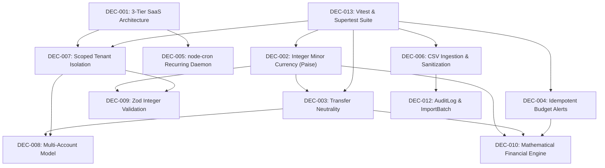

# Architecture & Project Decisions (DECISIONS.md)

**Project:** SmartSpend (FinTech & Personal Wealth Multi-Account Ledger Platform)  
**Maintained For:** Senior Engineers, Software Architects, AI Coding Agents, QA Engineers, Security Reviewers  
**Document Version:** 1.0.0  
**Repository State:** Verified against `SmartSpend_Comprehensive_Documentation.md`  

---

## Purpose

This document records and preserves foundational architectural, technical, security, financial data, API, infrastructure, and business-logic decisions for **SmartSpend**. Its primary objective is to guarantee that future developers, system maintainers, and autonomous AI coding agents do not repeatedly re-infer, contradict, or accidentally dismantle intentionally chosen financial engineering and architectural patterns.

---

## Rules for Future AI Agents

1. **Mandatory Pre-Flight Read:** Always consult this document before proposing, designing, or implementing architecture-level or ledger-level changes.
2. **Treat "CONFIRMED" Decisions as Hard Constraints:** Never bypass or contradict a `CONFIRMED` decision without explicit human review and approval.
3. **Financial Precision Non-Negotiable:** Under no circumstance shall monetary values be converted to IEEE 754 floating-point numbers (`DEC-002`). All persistence and mathematical operations must remain in integer minor units (paise for INR).
4. **Preserve Transfer Neutrality:** Never aggregate account transfers (`type: 'transfer'`) into monthly Income or Expense P&L reports (`DEC-003`).
5. **No Silent Replacements:** Naive implementations (e.g. unindexed MongoDB queries, un-sanitized CSV cell parsing, or duplicate budget notifications) are strictly prohibited.
6. **Identify Conflicts First:** If a requested feature appears to conflict with a confirmed decision, state the conflict and obtain human confirmation before proceeding.
7. **Preserve Rationale:** When modifying or superseding an architecture decision, preserve the historical entry, mark it as `SUPERSEDED`, and cross-reference the replacement.
8. **No Speculative Fabrications:** Only document decisions supported by repository evidence. If evidence is lacking, label the item as `INFERRED — NOT CONFIRMED`.

---

## Decision Index

| ID | Decision Name | Status | Area |
| :--- | :--- | :---: | :--- |
| **DEC-001** | Decoupled 3-Tier SaaS Architecture (React 18 SPA + Node.js Express API v1 + MongoDB 7.x) | CONFIRMED | Architecture |
| **DEC-002** | Integer Minor Currency Standard (Paise for INR: ₹1.00 = 100 paise) for Absolute Precision | CONFIRMED | Mathematical Ledger |
| **DEC-003** | Dual-Entry Atomic Transfer Neutrality (No Income/Expense Distortion) | CONFIRMED | Business Logic / Ledger |
| **DEC-004** | Idempotent Array-Tracked Budget Alert Engine (`alertThresholdsFired`) | CONFIRMED | Business Logic / Notifications |
| **DEC-005** | node-cron Automated Recurring Transaction Daemon with Forward Date Math | CONFIRMED | Backend / Scheduling |
| **DEC-006** | CSV Bank Ingestion Pipeline with Formula Macro Sanitization & MD5 Fingerprint Deduplication | CONFIRMED | Security / Ingestion |
| **DEC-007** | Strict Multi-Tenant Scoped Isolation & BOLA Defense (`userId: req.user.id`) | CONFIRMED | Security / Auth |
| **DEC-008** | Multi-Account Classification Model (Cash, Bank, Wallet, Credit Tracking, Emergency Fund) | CONFIRMED | Database / Data Model |
| **DEC-009** | Dual-Layer Validation & Sanitization (Zod Integer Guard + DOMPurify XSS Mitigation) | CONFIRMED | Security / API |
| **DEC-010** | Mathematical Financial Metric Engine with Zero-Division Guards | CONFIRMED | Business Logic / Analytics |
| **DEC-011** | Streaming ExcelJS Multi-Sheet Financial Export & PDFKit Summary Reports | CONFIRMED | Reporting / Export |
| **DEC-012** | Forensic Append-Only Ledger (`AuditLog`) & CSV Batch Traceability (`ImportBatch`) | CONFIRMED | Compliance / Security |
| **DEC-013** | Vitest and Supertest Automated Testing Suite with Isolated Financial Test Fixtures | CONFIRMED | QA / Testing |

---

## Documented Architectural Decisions

### DEC-001 — Decoupled 3-Tier SaaS Architecture (React 18 SPA + Node.js Express API v1 + MongoDB 7.x)
- **Status:** CONFIRMED
- **Date:** 2026-11-05
- **Area:** Architecture
- **Decision:** Architect SmartSpend as three decoupled tiers:
  1. Client Presentation Tier: React 18 SPA built with Vite, Tailwind CSS, TanStack Query, Zustand, and Recharts.
  2. Application & Gateway Tier: Node.js LTS with Express.js REST API (`/api/v1`), node-cron background recurring scheduler, Papa Parse ingestion engine, and ExcelJS export pipeline.
  3. Data Persistence Tier: MongoDB 7.x cluster with Mongoose ODM (User-scoped collections, compound indexes, and atomic document operations).
- **Why:** Separates high-frequency interactive visual charting (cash flow curves, category donuts) from stateful transactional ledger processing and background cron daemons. A strictly versioned REST API (`/api/v1`) enables seamless future mobile app integrations (React Native/Flutter) without altering server business logic.
- **Problem Solved:** Prevents monolithic server-side template bottlenecks and couples financial calculation logic to a headless, highly-testable API layer.
- **Alternatives Considered:** Full-stack Next.js 14 App Router.
- **Why Alternatives Were Rejected:** Long-running scheduled background tasks (node-cron recurring bill generation) and heavy memory-intensive CSV/Excel parsing pipelines are far more reliable on dedicated Node.js Express runtime processes than serverless Next.js edge/lambda invocations.
- **Constraints:** Requires CORS configuration with credentials support, secure HttpOnly cookie forwarding, and reverse proxy routing.
- **Impact:** Entire codebase topology.
- **Evidence:** `SmartSpend_Comprehensive_Documentation.md` (Chapter 2: High-Level System Topology & Architecture; Chapter 10: Production Directory Architecture).
- **Change Risk:** Extreme. Modifying the 3-tier boundary breaks API routing, static asset caching, and background job execution.
- **Related Decisions:** DEC-005, DEC-007, DEC-013.

---

### DEC-002 — Integer Minor Currency Standard (Paise for INR: ₹1.00 = 100 paise) for Absolute Precision
- **Status:** CONFIRMED
- **Date:** 2026-11-05
- **Area:** Mathematical Ledger
- **Decision:** All monetary transactions, account balances, budget caps, goals, and contributions must be stored, computed, and transmitted across APIs strictly as 64-bit integer minor currency units (paise for INR). Floating-point arithmetic (`0.1 + 0.2 === 0.30000000000000004`) is strictly prohibited in database schemas, calculations, and validators. Formatting into rupee currency strings (e.g. `₹1,25,000.50`) is restricted exclusively to the presentation boundary via `Intl.NumberFormat('en-IN')`.
- **Why:** Standard IEEE 754 double-precision floating-point arithmetic produces cumulative precision degradation when adding or subtracting cents/paise over large ledgers, resulting in off-by-one errors and audit failures.
- **Problem Solved:** Guarantees absolute mathematical determinism across all ledger calculations, balance rollups, and reporting aggregations.
- **Alternatives Considered:** Native floating-point numbers; `decimal.js` / `bignumber.js` string serialization.
- **Why Alternatives Were Rejected:** Floating-point introduces rounding discrepancies. Third-party big decimal libraries add significant overhead to MongoDB queries and complicate index performance compared to native integer indexing.
- **Constraints:** Zod validators must reject any decimal inputs (`z.number().int().positive()`).
- **Impact:** All models (`Transaction`, `Account`, `Budget`, `SavingsGoal`, `GoalContribution`), finance calculation engines, and client input forms.
- **Evidence:** `SmartSpend_Comprehensive_Documentation.md` (Chapter 3: Mathematical Ledger Formulation & Integer Currency; Chapter 11: Enterprise Security Hardening).
- **Change Risk:** Critical. Introducing floats will corrupt ledger consistency and invalidate historical balance records.
- **Related Decisions:** DEC-003, DEC-009, DEC-010.

---

### DEC-003 — Dual-Entry Atomic Transfer Neutrality (No Income/Expense Distortion)
- **Status:** CONFIRMED
- **Date:** 2026-11-05
- **Area:** Business Logic / Ledger
- **Decision:** Inter-account transfers (e.g. moving ₹5,000 from Savings to UPI Wallet) must be recorded as a single atomic transaction document with `type: 'transfer'`, specifying `fromAccountId` and `toAccountId`. Transfer records must be strictly excluded from monthly Income and Expense aggregations (`{ type: { $in: ['income', 'expense'] } }`). Account balances must update symmetrically: source decreases, destination increases.
- **Why:** In amateur financial trackers, withdrawing cash or topping up a digital wallet is often recorded as an expense, artificially inflating spending metrics and creating false deficit alerts.
- **Problem Solved:** Guarantees transfer neutrality: transfers shift liquidity between accounts without distorting monthly Net Cash Flow or Profit & Loss figures.
- **Alternatives Considered:** Creating two separate transaction records (one expense, one income) tagged with a transfer flag.
- **Why Alternatives Were Rejected:** Two-record setups risk orphaned records if one write succeeds and the other fails, and require complicated aggregation filters to avoid doubling cash flow. A single document with dual account references guarantees atomicity.
- **Constraints:** MongoDB transactions or atomic `$inc` updates must ensure both accounts mutate simultaneously.
- **Impact:** `Transaction` schema, `transferService.js`, `dashboardController.js`, `cashflow` reports.
- **Evidence:** `SmartSpend_Comprehensive_Documentation.md` (Chapter 4: Multi-Account Management & Dual-Entry Transfers).
- **Change Risk:** High. Any query omitting `{ type: { $in: ['income', 'expense'] } }` will distort user analytics.
- **Related Decisions:** DEC-002, DEC-008, DEC-010.

---

### DEC-004 — Idempotent Array-Tracked Budget Alert Engine (`alertThresholdsFired`)
- **Status:** CONFIRMED
- **Date:** 2026-11-05
- **Area:** Business Logic / Notifications
- **Decision:** Budget documents track triggered notification tiers using an internal array: `alertThresholdsFired: ['50', '75', '90', '100']`. When an expense is recorded or updated, the evaluator computes `utilization = (spent / budgetAmount) * 100` and only generates an in-app `Notification` if the threshold has not already been logged. When the calendar month rolls over, the array is reset.
- **Why:** Naive budget notification triggers fire an alert on every single transaction recorded once spending crosses 80%, spamming the user dozens of times.
- **Problem Solved:** Ensures deterministic, non-duplicate alerts. Each threshold triggers exactly one notification per monthly billing cycle.
- **Alternatives Considered:** Stateless evaluation on every page load; Boolean flag `alertSent: true`.
- **Why Alternatives Were Rejected:** Stateless evaluation spams on every refresh. A single boolean flag cannot distinguish between warning (75%), critical (90%), and overrun (100%) tiers.
- **Constraints:** Monthly rollover must reset `alertThresholdsFired` atomically.
- **Impact:** `Budget` model, `budgetEvaluator.js`, `Notification` model, in-app notification center.
- **Evidence:** `SmartSpend_Comprehensive_Documentation.md` (Chapter 5: Category-Based Budgeting & Non-Duplicate Alerts).
- **Change Risk:** Medium. Bugs in threshold tracking could silence critical overspending warnings or cause duplicate notifications.
- **Related Decisions:** DEC-001, DEC-007.

---

### DEC-005 — node-cron Automated Recurring Transaction Daemon with Forward Date Math
- **Status:** CONFIRMED
- **Date:** 2026-11-05
- **Area:** Backend / Scheduling
- **Decision:** Recurring fixed expenses (subscriptions, rent, insurance, loan EMIs) are managed by a background `node-cron` daemon running daily at `00:01:00 UTC`. The daemon queries active rules (`isActive: true`, `startDate <= now`, `nextRunAt <= now`), performs an idempotency check to verify a transaction has not already been created for that date, creates the transaction document with `source: 'recurring'`, and advances `nextRunAt` according to frequency (Daily, Weekly, Monthly, Yearly).
- **Why:** Users frequently forget to log routine recurring bills, leading to inaccurate ledger balances and cash flow blind spots.
- **Problem Solved:** Provides automated ledger accuracy and enables forward cash flow forecasting.
- **Alternatives Considered:** Client-side generation on user login; external AWS EventBridge / Google Cloud Tasks triggers.
- **Why Alternatives Were Rejected:** Client-side triggers fail if the user does not log in for weeks, corrupting retrospective monthly reports. `node-cron` within the Express application keeps the system self-contained and free of external cloud infrastructure lock-in.
- **Constraints:** Must include server restart recovery and handle edge-of-month calendar dates (e.g. Feb 28/29, 30-day months) gracefully.
- **Impact:** `RecurringRule` model, `recurringCron.js`, `Transaction` model.
- **Evidence:** `SmartSpend_Comprehensive_Documentation.md` (Chapter 6: Automated Recurring Transaction Scheduler).
- **Change Risk:** High. Scheduling failures or duplicate date advancements can create multiple duplicate transaction records.
- **Related Decisions:** DEC-001, DEC-002, DEC-007.

---

### DEC-006 — CSV Bank Ingestion Pipeline with Formula Macro Sanitization & MD5 Fingerprint Deduplication
- **Status:** CONFIRMED
- **Date:** 2026-11-05
- **Area:** Security / Ingestion
- **Decision:** Bank statement CSV processing implements a strict 2-stage pipeline (Preview & Confirm) with two core security/integrity safeguards:
  1. Formula Macro Injection Defense: Every raw text cell starting with `=`, `+`, `-`, or `@` is prepended with a single apostrophe (`'`) to neutralize executable Excel/Sheets command execution.
  2. MD5 Fingerprint Deduplication: For every row, computes an MD5 hash over $\text{MD5}(\text{date} + \text{amountMinor} + \text{accountId} + \text{description})$. Rows matching existing database records are flagged as duplicates in the preview table.
- **Why:** Exported bank statements downloaded by users often contain malicious payload strings in merchant descriptions, and users frequently re-upload overlapping date ranges.
- **Problem Solved:** Prevents CSV formula injection attacks on user workstations and stops duplicate transactions from corrupting account balances.
- **Alternatives Considered:** Direct un-parsed bulk insert; fuzzy string matching.
- **Why Alternatives Were Rejected:** Direct insert is vulnerable to injection and duplicates. Fuzzy matching without hashing creates high false-positive rates on recurring identical transactions (e.g. daily metro commute).
- **Constraints:** Requires Multer file size limits (max 5MB) and strict CSV MIME type validation.
- **Impact:** `csvParser.js`, `importController.js`, `ImportBatch` model, preview UI.
- **Evidence:** `SmartSpend_Comprehensive_Documentation.md` (Chapter 7: Bank Statement CSV Ingestion & Deduplication; Chapter 11).
- **Change Risk:** High. Weakening sanitization exposes users to malware when exporting to Excel; altering fingerprint logic causes mass duplicates.
- **Related Decisions:** DEC-002, DEC-009, DEC-012.

---

### DEC-007 — Strict Multi-Tenant Scoped Isolation & BOLA Defense (`userId: req.user.id`)
- **Status:** CONFIRMED
- **Date:** 2026-11-05
- **Area:** Security / Auth
- **Decision:** Every MongoDB database query, update, and deletion across all 11 collections must explicitly include `userId: req.user.id` derived from the verified JWT session. Even when querying by a document's primary `_id`, the user scope is strictly appended: `{ _id: req.params.id, userId: req.user.id }`.
- **Why:** Broken Object Level Authorization (OWASP API1:2023 BOLA) is the most critical vulnerability in financial software. Without explicit user scoping, an attacker can enumerate transaction IDs or account IDs to read or manipulate another user's financial records.
- **Problem Solved:** Enforces complete cryptographic multi-tenant isolation at the query execution level.
- **Alternatives Considered:** Relying on client-sent user IDs; application-layer post-query ownership checks.
- **Why Alternatives Were Rejected:** Client-sent user IDs are trivially spoofed. Post-query checks waste database resources and fail catastrophically if an engineer forgets to add the check in a controller.
- **Constraints:** All collection indexes must begin with `{ userId: 1, ... }` as a compound prefix for maximum query performance.
- **Impact:** All controllers, models, and middleware.
- **Evidence:** `SmartSpend_Comprehensive_Documentation.md` (Chapter 11: Enterprise Security Hardening & Financial Threat Defense).
- **Change Risk:** Critical. Removing `userId` filters causes instantaneous data breaches across users.
- **Related Decisions:** DEC-001, DEC-008, DEC-012.

---

### DEC-008 — Multi-Account Classification Model (Cash, Bank, Wallet, Credit Tracking, Emergency Fund)
- **Status:** CONFIRMED
- **Date:** 2026-11-05
- **Area:** Database / Data Model
- **Decision:** Support distinct financial account types: `cash`, `savings`, `current`, `wallet`, `credit_card`, and `emergency_fund`. Each account maintains an `openingBalanceMinor` integer. Current balance is derived dynamically or tracked via audited atomic increments.
- **Why:** Modern consumers manage money across multiple distributed instruments (cash in hand, bank accounts, UPI digital wallets, and credit cards). Tracking everything as a single pool makes reconciliation impossible.
- **Problem Solved:** Reflects real-world financial topology, separates assets from credit liabilities, and ring-fences emergency savings.
- **Alternatives Considered:** Single global balance with category tagging.
- **Why Alternatives Were Rejected:** Cannot track real bank statements, cannot perform inter-account transfers, and cannot reconcile cash-in-hand discrepancies.
- **Constraints:** Deleting an account with associated transactions must be soft-archived (`isArchived: true`) rather than hard-deleted to preserve ledger integrity.
- **Impact:** `Account` model, `accountController.js`, account balance cards in UI.
- **Evidence:** `SmartSpend_Comprehensive_Documentation.md` (Chapter 4: Multi-Account Management; Chapter 8: Database Architecture).
- **Change Risk:** High. Schema modifications impact transfer routing and net worth calculations.
- **Related Decisions:** DEC-002, DEC-003, DEC-010.

---

### DEC-009 — Dual-Layer Validation & Sanitization (Zod Integer Guard + DOMPurify XSS Mitigation)
- **Status:** CONFIRMED
- **Date:** 2026-11-05
- **Area:** Security / API
- **Decision:** Implement strict two-stage payload processing:
  1. Zod Validation Middleware: Validates all request bodies, query parameters, and route params before reaching controllers. Rejects negative or non-integer amounts, unknown fields, and invalid dates.
  2. DOMPurify Sanitization: Sanitizes user-provided string fields (transaction descriptions, notes, category names, goal titles) to eliminate HTML tags and JavaScript event handlers.
- **Why:** Defends against NoSQL query operator injection (`$gt`, `$where`), stored cross-site scripting (XSS), and data corruption caused by malformed input types.
- **Problem Solved:** Ensures only clean, strongly-typed financial data enters the application tier and database persistence layer.
- **Alternatives Considered:** Express-validator; Joi; manual if-else checks in controllers.
- **Why Alternatives Were Rejected:** Zod provides superior TypeScript/JavaScript schema inference, composability, and clean middleware integration. Manual checks are error-prone and inconsistently implemented.
- **Constraints:** Must provide detailed, human-readable error messages for client forms without leaking stack traces.
- **Impact:** `server/src/validators/`, all routes and controllers.
- **Evidence:** `SmartSpend_Comprehensive_Documentation.md` (Chapter 11: Enterprise Security Hardening).
- **Change Risk:** Medium. Relaxing validation schemas can admit malformed data into ledger tables.
- **Related Decisions:** DEC-002, DEC-006, DEC-007.

---

### DEC-010 — Mathematical Financial Metric Engine with Zero-Division Guards
- **Status:** CONFIRMED
- **Date:** 2026-11-05
- **Area:** Business Logic / Analytics
- **Decision:** Centralize all financial analytics in `calculationEngine.js`. Formulate:
  1. Account Balance: $\text{Balance} = \text{Opening} + \sum \text{Income} - \sum \text{Expense} + \sum \text{TransfersIn} - \sum \text{TransfersOut}$
  2. Net Cash Flow: $\text{Total Income} - \text{Total Expenses}$ (transfers excluded)
  3. Savings Rate: $((\text{Income} - \text{Expenses}) / \text{Income}) \times 100$. If $\text{Income} = 0$, explicitly return `0` or `'N/A'` rather than computing `NaN` or `Infinity`.
  4. Budget Utilization: $(\text{Expenses} / \text{Budget}) \times 100$.
- **Why:** Computing financial ratios across scattered frontend components leads to inconsistent reports, division-by-zero crashes, and rounding bugs.
- **Problem Solved:** Guarantees uniform, mathematically bulletproof financial metrics across all dashboard cards, reports, and export sheets.
- **Alternatives Considered:** On-the-fly client-side JavaScript math in React components.
- **Why Alternatives Were Rejected:** Client-side math requires transmitting entire transaction histories to the browser, destroying performance on large ledgers and exposing calculations to client-side rounding bugs.
- **Constraints:** Calculations must run efficiently over indexed MongoDB aggregation pipelines.
- **Impact:** `calculationEngine.js`, `dashboardController.js`, `reportsController.js`.
- **Evidence:** `SmartSpend_Comprehensive_Documentation.md` (Chapter 3: Core Financial Formulas).
- **Change Risk:** High. Altering formulas changes user net worth and savings statistics.
- **Related Decisions:** DEC-002, DEC-003, DEC-004.

---

### DEC-011 — Streaming ExcelJS Multi-Sheet Financial Export & PDFKit Summary Reports
- **Status:** CONFIRMED
- **Date:** 2026-11-05
- **Area:** Reporting / Export
- **Decision:** Financial exports provide two formats:
  1. ExcelJS Multi-Sheet Workbooks: Includes formatted sheets for `Overview & Net Cash Flow`, `All Transactions`, `Account Balances`, and `Budget Performance` with formatted Indian currency cells and header styling.
  2. PDFKit Printable Summaries: Formal monthly spending summaries with category charts and key ratios.
  Exports are generated as streams to prevent memory bloat.
- **Why:** Personal wealth platforms require exportability for tax filing, loan applications, and personal archiving.
- **Problem Solved:** Eliminates client-side memory exhaustion and delivers professional, accountant-ready financial spreadsheets.
- **Alternatives Considered:** Client-side CSV generation via `Blob`; basic unformatted CSV dumps.
- **Why Alternatives Were Rejected:** Client-side CSV cannot produce multi-sheet styled Excel workbooks, cannot format currency columns properly, and crashes mobile browsers on large datasets.
- **Constraints:** Must stream data directly to `res` with appropriate `Content-Disposition` headers.
- **Impact:** `exportService.js`, `reportsController.js`.
- **Evidence:** `SmartSpend_Comprehensive_Documentation.md` (Chapter 9: REST API Specification; Chapter 10: Production Directory Architecture).
- **Change Risk:** Low to Medium. Formatting adjustments do not mutate underlying ledger data.
- **Related Decisions:** DEC-001, DEC-002, DEC-006.

---

### DEC-012 — Forensic Append-Only Ledger (`AuditLog`) & CSV Batch Traceability (`ImportBatch`)
- **Status:** CONFIRMED
- **Date:** 2026-11-05
- **Area:** Compliance / Security
- **Decision:** Maintain two specialized audit collections:
  1. `AuditLog`: Append-only record tracking security-sensitive operations (password change, account archival, large transaction edits, batch deletes) with timestamp, user ID, IP address, and payload diff.
  2. `ImportBatch`: Audit container recording every CSV upload session (filename, row count, duplicate count, successful count, error summary) with all imported transactions tagged by `importBatchId`.
- **Why:** In financial systems, the ability to trace who modified what record, when, and from what source is mandatory for dispute resolution and rollback of accidental bulk imports.
- **Problem Solved:** Enables full rollback of bad CSV imports (delete by `importBatchId`) and provides forensic tracking for security events.
- **Alternatives Considered:** Standard server logging to stdout/Winston without database persistence.
- **Why Alternatives Were Rejected:** Ephemeral logs are easily rotated away, cannot be queried relationally by users to undo an import batch, and provide no user-facing auditability.
- **Constraints:** `AuditLog` documents must be immutable; updates and deletes on this collection are disabled at the ODM level.
- **Impact:** `AuditLog.js`, `ImportBatch.js`, `importService.js`, `auditMiddleware.js`.
- **Evidence:** `SmartSpend_Comprehensive_Documentation.md` (Chapter 8: Database Architecture & Complete Mongoose Schemas).
- **Change Risk:** Medium. Affects audit compliance and bulk import rollback functionality.
- **Related Decisions:** DEC-006, DEC-007.

---

### DEC-013 — Vitest and Supertest Automated Testing Suite with Isolated Financial Test Fixtures
- **Status:** CONFIRMED
- **Date:** 2026-11-05
- **Area:** QA / Testing
- **Decision:** Financial correctness, ledger calculations, and API contracts are verified using Vitest and Supertest against dedicated in-memory or staging MongoDB test databases. Mandatory test suites:
  1. Integer Precision Suite (validating 64-bit integer paise without floating-point artifacts)
  2. Transfer Neutrality Suite (verifying zero net cash flow change on inter-account transfers)
  3. Zero-Income Savings Rate Suite (asserting graceful handling of zero income)
  4. Tenant Data Isolation Suite (testing BOLA 403/404 rejection on cross-user queries)
  5. Idempotent Recurring Cron Suite (asserting single transaction creation on dual execution)
  6. Budget Alert Non-Duplication Suite (asserting single notification per threshold)
  7. CSV Formula Injection Defense Suite (asserting malicious cells are neutralized)
- **Why:** Manual testing cannot reliably detect floating-point rounding drifts, race conditions in dual-entry transfers, or cross-tenant query leaks.
- **Problem Solved:** Guarantees mathematical and security regression prevention across every release.
- **Alternatives Considered:** Jest + Mocha.
- **Why Alternatives Were Rejected:** Vitest provides native ESM support, significantly faster test execution, unified configuration with Vite, and seamless TypeScript/JavaScript compatibility.
- **Constraints:** Tests must tear down database collections after execution and run independently.
- **Impact:** `server/tests/`, CI/CD test pipelines.
- **Evidence:** `SmartSpend_Comprehensive_Documentation.md` (Chapter 12: QA Automation & Financial Correctness Test Suite).
- **Change Risk:** Low (testing code), but vital for guarding all other decisions.
- **Related Decisions:** DEC-002, DEC-003, DEC-004, DEC-005, DEC-006, DEC-007.

---

## Decision Dependency Analysis

- Changing **DEC-002 (Integer Currency)** will invalidate **DEC-003**, **DEC-009**, **DEC-010**, and **DEC-013**.
- Modifying **DEC-003 (Transfer Neutrality)** will directly corrupt **DEC-008** and **DEC-010**.
- Changing **DEC-007 (Tenant Isolation)** exposes all models and invalidates security across the entire platform.

---

## Change Protocol for Future Agents

Before changing an established architecture decision:
1. **Locate Decision:** Identify the specific `DEC-XXX` record.
2. **Review Rationale:** Understand why the decision was intentionally made.
3. **Assess Blast Radius:** Consult `IMPACT-MAP.md` and the Decision Dependency Graph.
4. **Identify Conflicting Requirements:** Document why the existing architecture cannot accommodate the new requirement.
5. **Formulate Proposed Replacement:** Specify the new architecture, alternatives considered, and rejection rationales.
6. **Request Human Review:** Halt and present the proposed architectural change to the human engineer.
7. **Execute Only Upon Approval:** Update implementation, mark historical decision as `SUPERSEDED`, and register the new decision ID.
