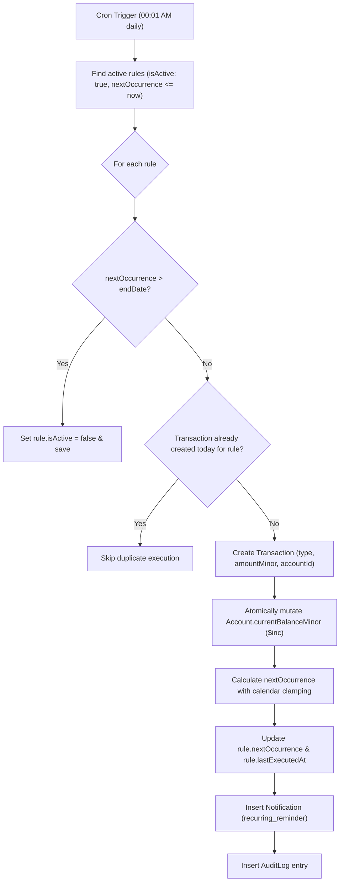

# SmartSpend — Recurring Transaction Engine & Background Daemon (RECURRING_JOBS.md)

**Daemon Library:** `node-cron`  
**Execution Cadence:** Daily at `00:01 AM` (`1 0 * * *`)  
**Architecture Rule:** Edge-of-month calendar forward math & atomic idempotency (`DEC-005`)

---

## 1. Engine Purpose & Scope

Personal finance platforms must handle recurring subscriptions (Netflix, Spotify), utility bills (Electricity, Internet), rental commitments, and automated salary credits without requiring manual user intervention.

The SmartSpend Recurring Engine provides:
1. **Multi-Cadence Scheduling:** Daily, Weekly, Monthly, and Yearly cycles.
2. **Edge-of-Month Calendar Clamping:** Accurate handling of months with varying day counts (28, 29, 30, 31).
3. **Atomic Duplicate Prevention:** Distributed idempotency preventing double-charging across server restarts.
4. **Ledger Synchronicity:** Automatic mutation of `Account.currentBalanceMinor` and creation of immutable `Transaction` records.
5. **In-App Notification Auditing:** Emits proactive reminders to user notification inboxes.
6. **On-Demand Manual Sweep Trigger:** Immediate evaluation endpoint for administrative or testing sweeps.

---

## 2. Forward Calendar Math Formulation (DEC-005)

### The JavaScript `setMonth()` Defect
In standard JavaScript `Date` arithmetic, incrementing a month from an edge-of-month date causes unexpected forward rollovers:

```javascript
const d = new Date(2026, 0, 31); // Jan 31, 2026
d.setMonth(d.getMonth() + 1);    // Rolls into March 3, 2026! (Feb only has 28 days)
```

This bug causes recurring February bills to fire in March, skipping February entirely and billing twice in March.

### SmartSpend Clamped Forward Math Formulation
SmartSpend preserves the intended anchor day by querying the maximum allowable days in the target month and clamping:

```javascript
export function calculateNextOccurrence(currentDate, frequency, startDate) {
  const d = new Date(currentDate);
  const anchorDay = startDate ? new Date(startDate).getDate() : d.getDate();

  switch (frequency) {
    case 'daily':
      d.setDate(d.getDate() + 1);
      break;

    case 'weekly':
      d.setDate(d.getDate() + 7);
      break;

    case 'monthly': {
      const targetYear = d.getFullYear() + (d.getMonth() === 11 ? 1 : 0);
      const targetMonth = (d.getMonth() + 1) % 12;
      // Get total days in target month (day 0 of next month)
      const maxDaysInTargetMonth = new Date(targetYear, targetMonth + 1, 0).getDate();
      const clampedDay = Math.min(anchorDay, maxDaysInTargetMonth);
      return new Date(targetYear, targetMonth, clampedDay, d.getHours(), d.getMinutes());
    }

    case 'yearly': {
      const targetYear = d.getFullYear() + 1;
      const targetMonth = d.getMonth();
      const maxDays = new Date(targetYear, targetMonth + 1, 0).getDate();
      const clampedDay = Math.min(anchorDay, maxDays);
      return new Date(targetYear, targetMonth, clampedDay, d.getHours(), d.getMinutes());
    }
  }

  return d;
}
```

#### Test Matrix:
- **Jan 31 $\to$ Monthly $\to$ Feb 28** (Clamped to 28)
- **Jan 31, 2028 (Leap Year) $\to$ Monthly $\to$ Feb 29** (Clamped to 29)
- **March 31 $\to$ Monthly $\to$ April 30** (Clamped to 30)
- **Feb 28 $\to$ Monthly $\to$ March 31** (Restored to anchor day 31)

---

## 3. Background Daemon Lifecycle & Idempotency



### Distributed Idempotency Guarantee
To prevent race conditions when multiple cluster nodes or testing threads execute simultaneously:
1. Before writing a transaction, the scheduler queries:
   ```javascript
   const todayStart = new Date(now.getFullYear(), now.getMonth(), now.getDate());
   const todayEnd = new Date(now.getFullYear(), now.getMonth(), now.getDate(), 23, 59, 59, 999);
   
   const existing = await Transaction.findOne({
     recurringRuleId: rule._id,
     transactionDate: { $gte: todayStart, $lte: todayEnd },
   });
   if (existing) continue; // Skip duplicate execution
   ```
2. Single source of truth: Even if the sweep is triggered manually 10 times in one day, exactly 1 transaction will ever be generated.

---

## 4. Manual Sweep API Endpoint

Users and integration tests can trigger an immediate evaluation sweep:

- **Method:** `POST`
- **Endpoint:** `/api/v1/recurring/sweep`
- **Auth:** Protected (derives `userId: req.user._id`)
- **Response:**
  ```json
  {
    "success": true,
    "message": "Recurring scheduler sweep executed successfully",
    "executedCount": 2
  }
  ```
